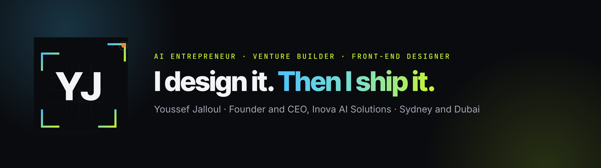
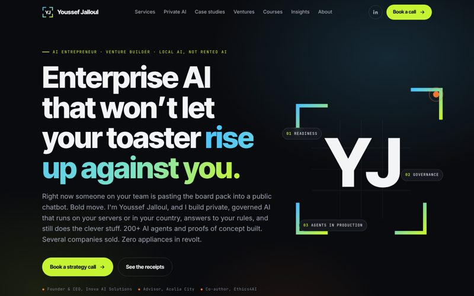
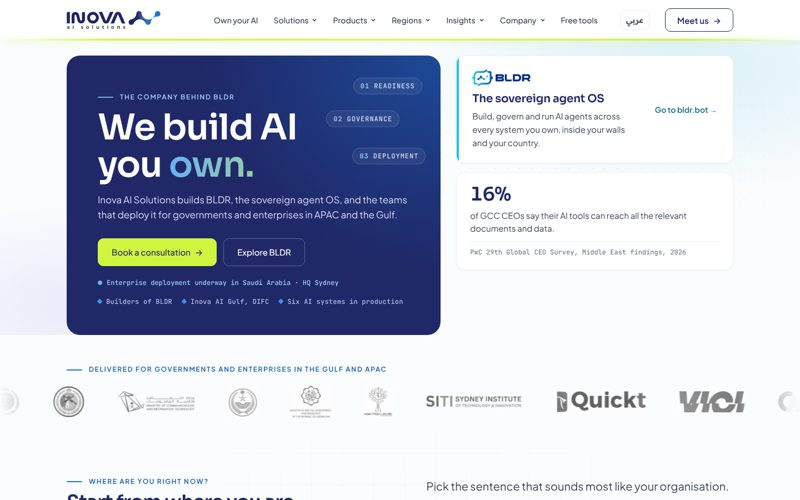
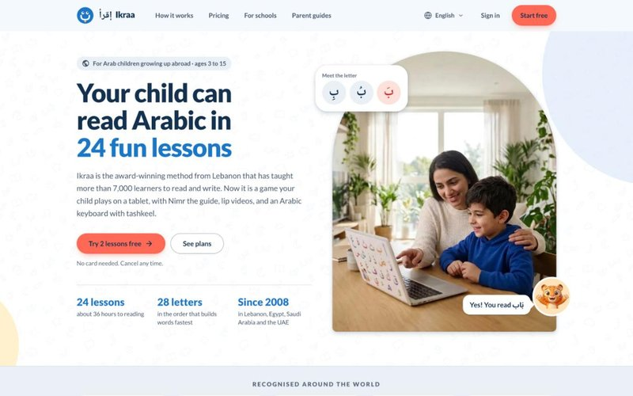
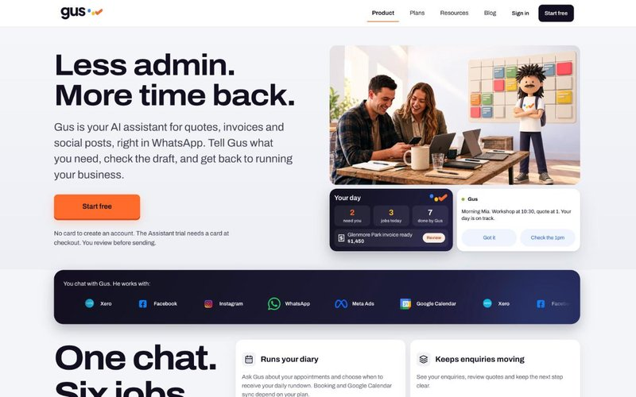
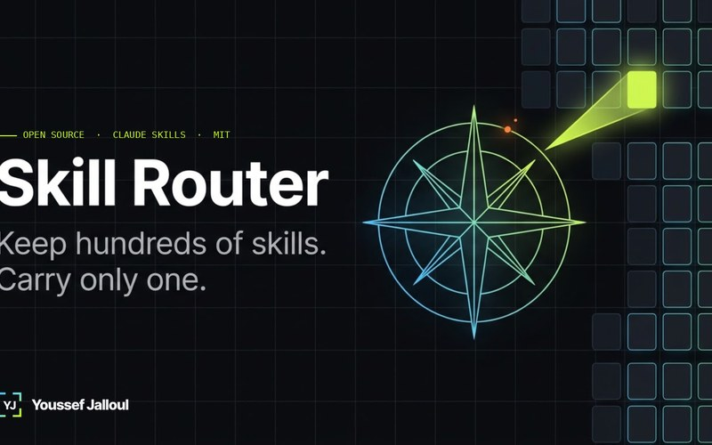

## Hi, I'm Youssef

**AI entrepreneur and venture builder. I design products, then I build them.** 20+ years, multiple exits, 200+ AI agents and proofs of concept created or implemented. Founder and CEO of [Inova AI Solutions](https://www.inovasolutions.ai), the company behind [BLDR OS](https://www.bldr.bot), the in-country enterprise AI operating system.

Every repo below is real, shipped work: the front end, plus a case study of how I got there (the problem, the metrics, Blue Ocean strategy, positioning and the UX decisions).

## Featured work

<table>
<tr>
<td width="50%" valign="top">

<b><a href="https://github.com/youssefjalloul-inova/youssefjalloul.com">youssefjalloul.com</a></b> 
My personal brand site. Positioning for enterprise buyers, a code-drawn illustration cast, a self-check tool and a machine layer for AI search.
</td>
<td width="50%" valign="top">

<b><a href="https://github.com/youssefjalloul-inova/inovasolutions.ai">inovasolutions.ai</a></b> 
44 pages in English and Arabic, five browser tools, and every section tagged to the buying committee it speaks to.
</td>
</tr>
<tr>
<td width="50%" valign="top">

<b><a href="https://github.com/youssefjalloul-inova/bldr.bot">bldr.bot</a></b> 
A 19-section product site cut to one page, one story and one action for enterprise buyers.
</td>
<td width="50%" valign="top">

<b><a href="https://ikraa.academy">ikraa.academy</a></b> 
Award-winning software that teaches Arabic reading and writing in under 36 hours. 7,000+ learners, now a game for children growing up abroad.
</td>
</tr>
<tr>
<td width="50%" valign="top">

<b><a href="https://higus.ai">higus.ai</a></b> 
Gus, an AI assistant that lives in WhatsApp and takes the admin off small businesses, entrepreneurs and service providers.
</td>
<td width="50%" valign="top">
<b>Sanad</b> (coming soon) 
An AI clinic assistant that takes the admin off doctors, nurses and medical staff, so they can spend more time with patients.
</td>
</tr>
<tr>
<td width="50%" valign="top">

<b><a href="https://github.com/yj-skill-library/skill-router">Skill Router</a></b> (open source) 
Keep hundreds of Claude skills and carry only one. A small router skill loads the right skill from a GitHub library, so Claude stops spending tokens on skills it isn't using.
</td>
<td width="50%" valign="top">
</td>
</tr>
</table>

## What I do

- **Front-end design and engineering:** static-first sites, design systems, motion, accessibility (WCAG 2.2 AA).
- **AI products:** enterprise AI on infrastructure the client owns, custom agents, AI-assisted build pipelines.
- **Brand universes:** story, voice, identity and the code that keeps them consistent.
- **Venture building:** [Gus](https://higus.ai) (live), Ikraa and more, under YJ Ventures.

## How I work

Break the box, build a new one, then think outside it. Every project starts with the problem and the metric, goes through a framework (Lean Strategy, Blue Ocean, the Flaming Corner), and ends in something shipped.

## Find me

[youssefjalloul.com](https://youssefjalloul.com) · [LinkedIn](https://www.linkedin.com/in/youssef-jalloul/) · [The AI Glittch newsletter](https://www.linkedin.com/newsletters/the-ai-glittch-7332984165379805188/) · [inovasolutions.ai](https://www.inovasolutions.ai)
